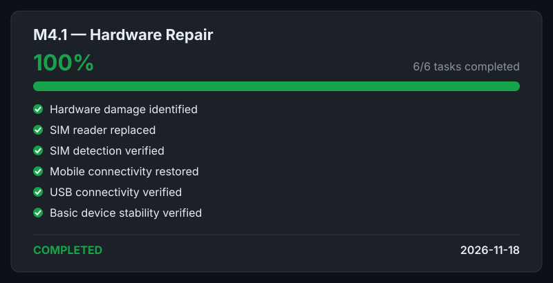

# KRYPTA OS

**A pocket-sized Linux cybersecurity laboratory.**

KRYPTA OS is a personal embedded Linux project focused on transforming Android smartphones into portable ARM64 cybersecurity laboratories.

> **Status:** Early development. The damaged SIM-reader flex cable has been repaired. The system has not yet booted on the target device.

> [!CAUTION]
> **EXPERIMENTAL SOFTWARE — USE AT YOUR OWN RISK**
>
> KRYPTA OS is a personal hobby project and is not intended for production use.
>
> Installing or flashing this software may cause **permanent data loss, device instability, or render your device unbootable (brick)**.
>
> There is **no guarantee of compatibility, functionality, or recovery**.
>
> You are solely responsible for any consequences of using this software.

## Project Goals

- Run native Linux on a repurposed smartphone.
- Build a minimal ARM64 root filesystem.
- Enable remote access through SSH.
- Configure Wi-Fi networking.
- Create a reproducible build process.
- Learn embedded Linux and cybersecurity.

## Target Hardware

| Component | Specification |
|---|---|
| Device | Xiaomi 11 Lite 5G NE |
| Codename | `lisa` |
| SoC | Snapdragon 778G |
| Architecture | ARM64 / AArch64 |
| Build host | Ubuntu Server 24.04 LTS (AMD64, VirtualBox) |
| Android | 14 / HyperOS |
| Bootloader | Locked; unlocking remains pending |

**Hardware repair:** The damaged SIM-reader flex cable was successfully replaced on
2026-11-18. SIM detection, mobile connectivity, Wi-Fi, USB charging, ADB,
Fastboot, and basic device stability have been verified under Android.
M4.1 — Hardware Repair is complete. Native Linux support remains under
investigation, and KRYPTA OS has not yet booted on the target device.

See [docs/hardware.md](docs/hardware.md) for detailed verification results and
photographic documentation.

<p align="center">
  
</p>

## Technology Stack

| Layer | Technology |
|---|---|
| Kernel | Linux |
| Base system | Alpine Linux / postmarketOS tooling |
| Build tools | Bash, GNU Make, ARM64 toolchain |
| Remote access | OpenSSH |
| Version control | Git |

## Planned Architecture

```text
KRYPTA OS
├── Device support
│   ├── ARM64 Linux kernel
│   ├── Device Tree
│   └── Hardware configuration
├── Root filesystem
│   ├── Alpine Linux base
│   ├── System services
│   └── Networking and SSH
├── Security laboratory
│   ├── Network diagnostics
│   └── Security tools
└── Build system
    ├── Environment checks
    └── Build scripts
```

## Development

Development runs in an Ubuntu Server VM on Windows 11, accessed with VS Code
Remote - SSH. GitHub operations are performed on Windows; committed history is
transferred to and from the VM with Git bundles. See
[docs/setup.md](docs/setup.md) for the setup and workflow.

List available commands:

```bash
make help
```

Run the environment validation:

```bash
make check
```

## Roadmap

See [ROADMAP.md](ROADMAP.md) for the development checklist.

## Disclaimer

KRYPTA OS is an experimental educational project for authorized cybersecurity research. Hardware support is not guaranteed.
