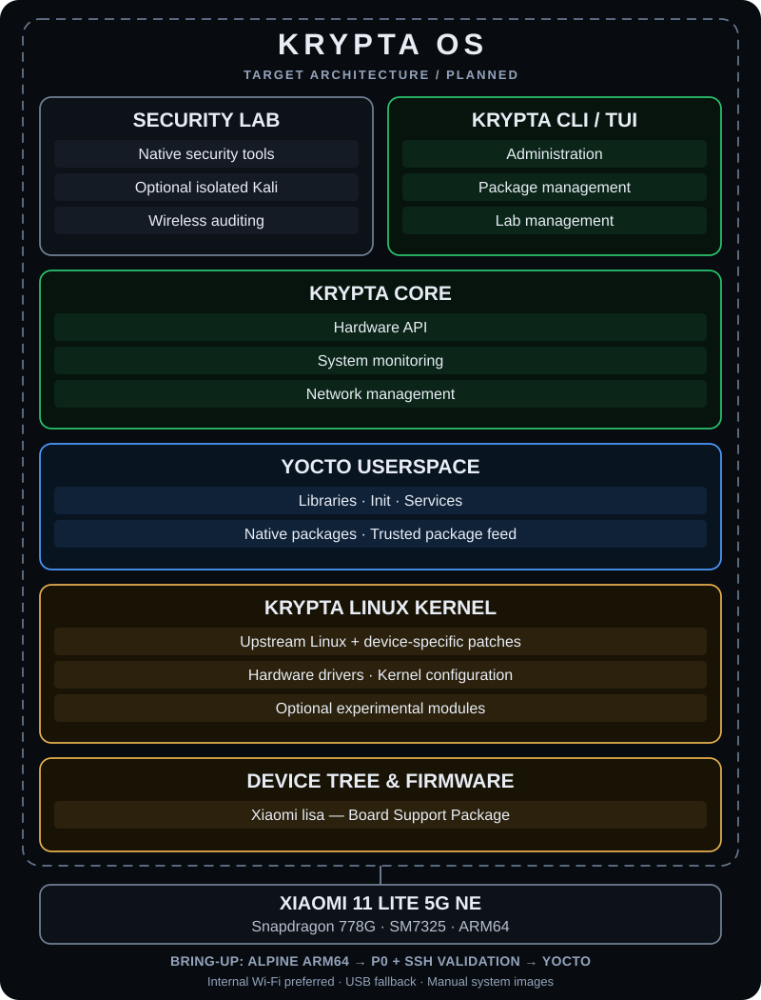

# KRYPTA OS

**A pocket-sized Linux cybersecurity laboratory.**

KRYPTA OS is a personal hobby, educational and engineering portfolio project that aims to turn a repurposed Xiaomi 11 Lite 5G NE into a native, headless ARM64 Linux system for authorized security research, network diagnostics and embedded Linux development. The repository is public for transparency and portfolio purposes; it is not a community distribution or a supported product.

> [!CAUTION]
> **EXPERIMENTAL SOFTWARE — USE AT YOUR OWN RISK.**
>
> Unlocking, booting or flashing experimental software may erase data, damage hardware (including through unsafe charging or thermal behavior), or permanently brick the device. Compatibility, functionality, safety and recovery are not guaranteed. This project is not intended for production use. Anyone attempting to reproduce it does so at their own risk. Back up data and establish a device-specific recovery procedure before modifying the device. Security testing must be limited to systems you own or are authorized to test.

## Current status

- Development VM and ARM64 cross-compilation/runtime smoke test verified (QEMU user mode).
- SIM-reader repair and basic Android hardware verification completed on 2026-11-18.
- Bootloader remains locked; official unlock authorization is pending.
- Native Linux has not yet been booted or flashed on the target.

## Planned architecture

<p align="center">
  
</p>

The initial bring-up uses a minimal Alpine ARM64 userspace. After essential hardware (P0) and SSH are validated, the project transitions to a custom Yocto-built distribution. One upstream-based Linux kernel is maintained with device-specific patches as needed and optional experimental modules. Native Yocto packages and a personal package feed power the custom CLI/TUI; Kali is an optional isolated environment, not the base distribution.

## v1.0 objectives

- Native Linux with persistent storage, headless administration and reliable SSH.
- Safe basic hardware operation and practical networking, including a hotspot where supported.
- Monitor mode and packet injection on a verified interface: built-in Wi-Fi preferred, USB adapter accepted.
- KRYPTA Core, Hardware API, monitoring, network management, CLI/TUI and native package management.
- Reproducible versioned images, manually installed system releases and a verified recovery path.

Android is preserved during controlled bring-up wherever feasible; the final goal is to replace it. No OTA service or public image distribution is planned. Educational reimplementations remain isolated from safety-critical device code.

## Development

```bash
make help
make check
make arm64-runtime-check
```

These commands run in the Ubuntu build VM; the runtime check proves execution of a test binary under QEMU, not native phone boot.

## Documentation

| Document | Purpose |
|---|---|
| [ROADMAP.md](ROADMAP.md) | Milestones, progress and blockers |
| [docs/setup.md](docs/setup.md) | Build host, toolchain and Git workflow |
| [docs/hardware.md](docs/hardware.md) | Device inventory, repair evidence and diagnostics |
| [docs/kernel-support.md](docs/kernel-support.md) | Source-backed hardware support and educational opportunities |