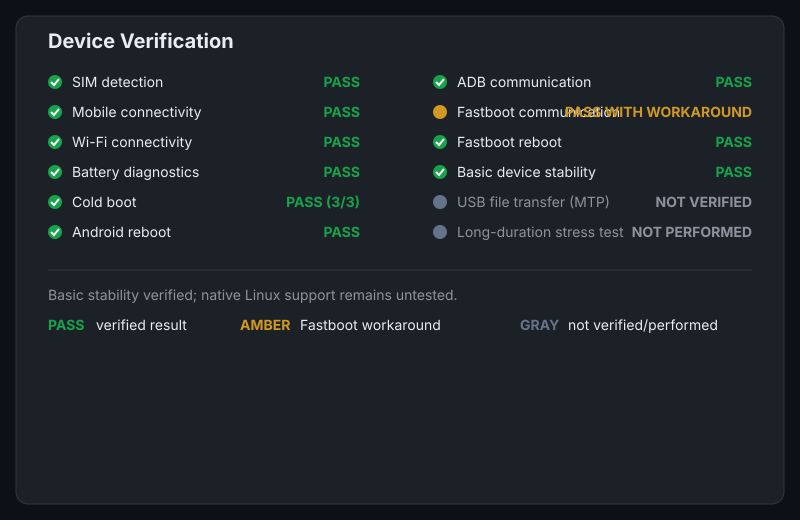
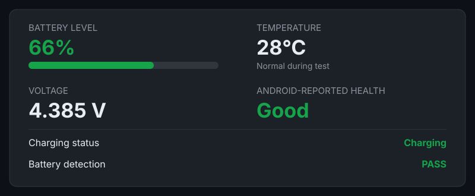
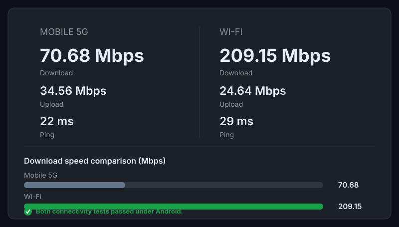
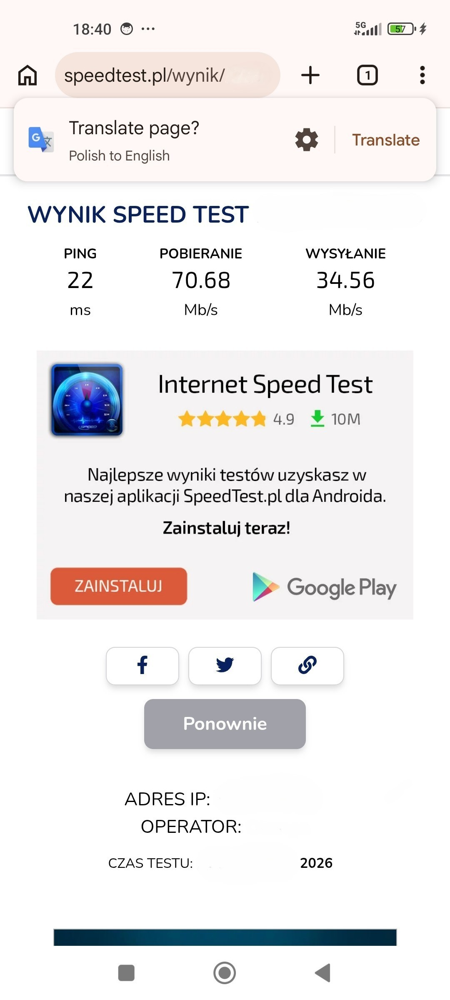
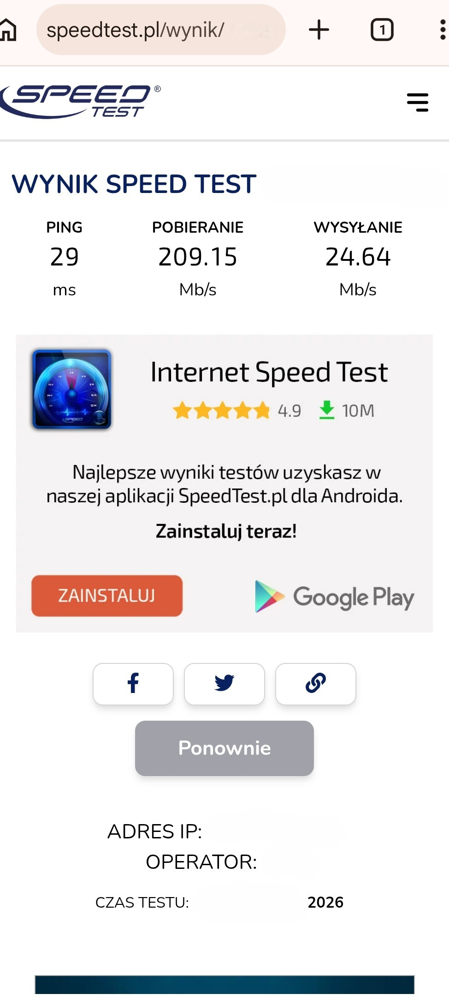

# Target Hardware — Xiaomi 11 Lite 5G NE

## Device

| Property | Value |
|---|---|
| Model | Xiaomi 11 Lite 5G NE (`2109119DG`) |
| Codename | `lisa` |
| SoC | Qualcomm Snapdragon 778G |
| CPU architecture | ARM64 / AArch64 |
| RAM | 8 GB variant (7.04 GiB reported by `/proc/meminfo`) |
| Internal storage | Likely 128 GB variant; total UFS capacity not independently verified |
| `/data` filesystem | 105 GiB total, 12 GiB used, 93 GiB available |
| Android | 14 (HyperOS) |
| Firmware | `V816.0.12.0.UKOEUOR` |
| Baseband | `4.3CPL2-gl-0210_0203_e418bd70ab1` |
| Battery model | BP42 |
| Typical battery design capacity | 4250 mAh |


## Confirmed device state

| Check | Result |
|---|---|
| ADB over USB | Working |
| Fastboot over USB | Working with USB reconnection workaround |
| `fastboot getvar product` | `lisa` |
| `fastboot getvar unlocked` | `no` |
| `fastboot getvar current-slot` | `b` |
| Android SIM state | `LOADED,ABSENT` |
| Wi-Fi under Android | Working |
| Mobile connectivity under Android | Working |
| USB charging | Working |
| Basic post-repair stability | Verified |
| Native Linux boot | Not yet attempted or verified |

The bootloader is **locked**. The rear cover remains missing; this external
cover has not been replaced. No KRYPTA OS image has been booted or flashed.
Slot, firmware and device state must be checked again before any bootloader or
partition operation.

## Partition Layout

Partition names and block-device mappings were inspected using
`adb shell ls -l /dev/block/by-name`.

The device uses an A/B boot scheme. The active slot was `b` at the time of the initial Fastboot inspection.

| Partition | Block device |
|---|---|
| `boot_a` / `boot_b` | `sde11` / `sde35` |
| `vendor_boot_a` / `vendor_boot_b` | `sde22` / `sde46` |
| `dtbo_a` / `dtbo_b` | `sde15` / `sde39` |
| `vbmeta_a` / `vbmeta_b` | `sde14` / `sde38` |
| `vbmeta_system_a` / `vbmeta_system_b` | `sda21` / `sda22` |
| `super` | `sda20` |
| `userdata` | `sda33` |
| `metadata` | `sda24` |
| `persist` | `sda8` |
| `modemst1` / `modemst2` | `sdf2` / `sdf3` |

The partition layout was inspected without modifying any block devices.

Partition mappings may change with firmware updates and must be reverified before any boot or flashing operation.

## Linux support

Linux boot, UFS, USB, Wi-Fi, hotspot, charging and power management on this device are **not yet verified**. Android functionality does not confirm support in a custom Linux kernel.

The intended first boot is a minimal **headless ARM64 Linux system**. Kernel source, device tree, firmware dependencies, boot image layout and a device-specific recovery procedure must be established before any flashing.

## SIM Reader Repair

### Original Hardware Issue

The original SIM-reader flex cable was physically damaged, preventing SIM card
detection and mobile network connectivity. This hardware issue prevented further
progress with SIM-dependent bootloader unlocking preparations.

### Hardware Repair

On 2026-11-18, the damaged SIM-reader flex cable was replaced with a compatible
replacement component. SIM card detection and mobile network connectivity were
successfully restored. All internal connectors, flex cables and protective covers
were reinstalled correctly. The missing external rear cover has not been replaced.

### Post-Repair Verification



| Test | Result | Notes |
|---|---|---|
| SIM-reader replacement | PASS | Replacement installed |
| SIM card detection | PASS | `LOADED,ABSENT` |
| Mobile connectivity | PASS | Multiple successful speed tests |
| Wi-Fi connectivity | PASS | Tested with mobile data disabled |
| USB charging | PASS | Charging confirmed |
| USB debugging | PASS | Device recognized by Android |
| ADB communication | PASS | Authorized and responsive |
| Fastboot communication | PASS WITH WORKAROUND | USB reconnection required |
| Cold boot | PASS | Three successful power cycles |
| Android reboot | PASS | Successfully verified |
| SIM detection after reboot | PASS | SIM detected after every tested restart |
| Fastboot reboot | PASS | Successfully returned to Android |
| Connector installation | PASS | Internal connections and covers secured |
| Basic device stability | PASS | No unexpected freezes or restarts observed during testing |
| USB file transfer (MTP) | NOT VERIFIED | File transfer option unavailable or not confirmed |
| Long-duration stress test | NOT PERFORMED | Outside the current verification scope |

Basic stability verification does not guarantee long-term hardware reliability.

### Battery Diagnostics

The following command was executed:

```text
adb shell dumpsys battery
```



| Parameter | Value |
|---|---|
| Battery level | 66% |
| Temperature | 28°C |
| Voltage | 4.385 V |
| Battery health reported by Android | Good |
| Battery health code | 2 |
| Charging status | Charging |
| Charging status code | 2 |
| Battery present | True |
| Maximum reported charging current | 1.7 A |
| Maximum reported charging voltage | 5 V |
| Battery technology | Li-poly |
| AC powered | True |
| USB powered | False |

Android classified the connected power source as AC power. This does not
establish a USB charging failure: USB charging was separately confirmed.
The battery health status reported by Android does not confirm actual remaining
battery capacity. The anomalous charge-counter reading was not used to estimate
battery capacity.

### Network Connectivity

Mobile connectivity was tested repeatedly over approximately ten minutes.
Multiple SpeedTest.pl measurements produced similar results without observed
connectivity failures. Wi-Fi was tested separately with mobile data disabled.



| Metric | Mobile 5G | Wi-Fi |
|---|---:|---:|
| Download | 70.68 Mbps | 209.15 Mbps |
| Upload | 34.56 Mbps | 24.64 Mbps |
| Ping | 22 ms | 29 ms |
| Result | PASS | PASS |

All tests were performed under Android. These tests do not establish native Linux
wireless driver compatibility or networking functionality under KRYPTA OS.

| Mobile 5G | Wi-Fi |
|---|---|
|  |  |

### ADB and Fastboot Verification

The following commands were used:

```text
adb devices -l
adb shell getprop ro.product.device
adb shell getprop gsm.sim.state
adb shell dumpsys battery
adb reboot
adb reboot bootloader
fastboot devices
fastboot getvar product
fastboot getvar unlocked
fastboot getvar current-slot
fastboot reboot
```

Relevant sanitized outputs:

```text
List of devices attached
<DEVICE_SERIAL>    device product:lisa_eea model:2109119DG device:lisa
```

```text
adb shell getprop ro.product.device
lisa
```

```text
adb shell getprop gsm.sim.state
LOADED,ABSENT
```

```text
fastboot devices
<DEVICE_SERIAL>    fastboot
```

```text
fastboot getvar product
product: lisa

fastboot getvar unlocked
unlocked: no

fastboot getvar current-slot
current-slot: b
```

Actual ADB and Fastboot device serial numbers are intentionally omitted.

### Device Stability

- Three successful power-off and power-on cycles.
- Successful Android reboot.
- SIM card detection after every tested restart.
- Repeated mobile internet speed tests over approximately ten minutes.
- Successful Wi-Fi connectivity test with mobile data disabled.
- Successful ADB communication after testing.
- Successful Fastboot communication after USB reconnection.
- Successful return to Android using `fastboot reboot`.
- Internal connectors and protective covers correctly installed.
- No unexpected freezes or spontaneous restarts observed during the verification period.

The device passed the project's basic pre-unlock stability verification.
Long-duration stability and stress testing have not been performed.

### Known Limitations

When switching from Android to Fastboot using `adb reboot bootloader`, Windows
does not immediately recognize the device in Fastboot mode. Physically
disconnecting and reconnecting the USB-C cable allows Fastboot communication
to work correctly. This behavior was reproduced multiple times.

Workaround:

1. Execute `adb reboot bootloader`.
2. Wait until the phone enters Fastboot mode.
3. Disconnect the USB-C cable.
4. Reconnect the USB-C cable.
5. Execute `fastboot devices`.
6. Verify that the device is listed.

USB re-enumeration or Windows driver behavior is a possible explanation, but
the root cause has not been confirmed.

Before future bootloader unlocking or partition-writing operations, verify that
Fastboot communication remains stable.

### Photographic Evidence

| Before repair | After repair |
|---|---|
|  |  |
| Damaged SIM-reader assembly and replacement component | Installed replacement SIM-reader flex cable |
