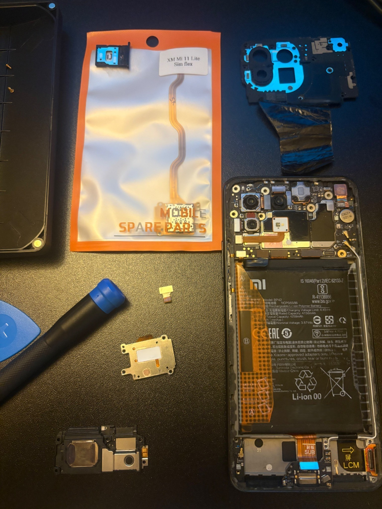
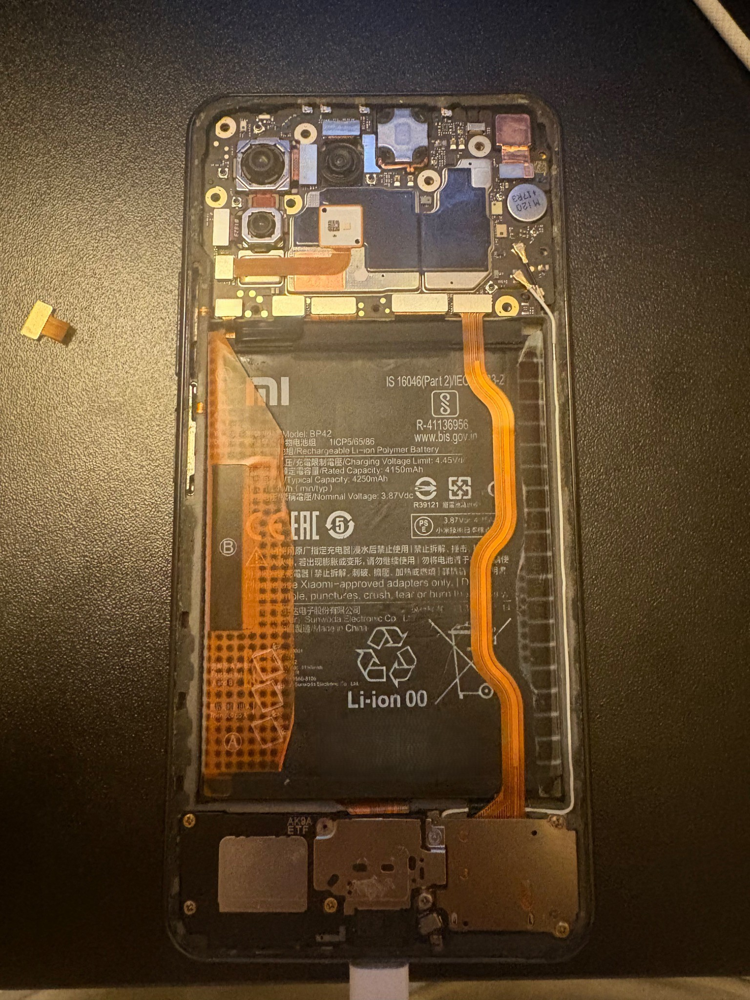

# Target Hardware — Xiaomi 11 Lite 5G NE

## Device inventory

| Property | Value at inspection |
|---|---|
| Model | Xiaomi 11 Lite 5G NE (`2109119DG`) |
| Codename | `lisa` |
| SoC / architecture | Qualcomm Snapdragon 778G (SM7325) / ARM64 |
| RAM | 8 GB variant (7.04 GiB reported by `/proc/meminfo`) |
| Storage | Likely 128 GB; raw UFS capacity not verified |
| `/data` capacity | 105 GiB total, 12 GiB used, 93 GiB free |
| Android / firmware | Android 14 / HyperOS `V816.0.12.0.UKOEUOR` |
| Baseband | `4.3CPL2-gl-0210_0203_e418bd70ab1` |
| Battery | BP42, typical design capacity 4250 mAh (not measured capacity) |
| Bootloader / active slot | Locked (`no`), slot `b` at inspection |
| Native Linux | Not yet booted or flashed |

The external rear cover remains missing. Protect exposed components and battery; stop testing if damage, swelling, abnormal heat or unsafe charging is observed. Recheck firmware, variant and slot before device modifications.

## SIM-reader repair — 2026-11-18

The damaged SIM-reader flex prevented SIM detection and mobile connectivity. A compatible replacement restored both. Internal connectors and protective covers were reinstalled; the external rear cover is still absent.

| Before repair | After repair |
|---|---|
|  |  |
| Damaged assembly and replacement | Installed SIM-reader flex |

### Post-repair verification (Android only)

| Check | Result |
|---|---|
| SIM detection and mobile connectivity | 🟢 PASS — `LOADED,ABSENT`; repeated mobile tests |
| Wi-Fi | 🟢 PASS — tested with mobile data disabled |
| USB charging/debugging and ADB | 🟢 PASS — authorized, responsive |
| Fastboot | 🟡 PASS WITH WORKAROUND — reconnect USB cable |
| Cold boot / Android reboot / return from Fastboot | 🟢 PASS — three cold boots; SIM remains detected |
| Basic stability | 🟢 PASS — no unexpected freezes/restarts during tests |
| MTP file transfer | ⚪ NOT VERIFIED |
| Long-duration stress test | ⚪ NOT PERFORMED |

<p align="center"></p>

### Network measurements

| Metric | Mobile 5G | Wi-Fi |
|---|---:|---:|
| Download | 70.68 Mbps | 209.15 Mbps |
| Upload | 34.56 Mbps | 24.64 Mbps |
| Ping | 22 ms | 29 ms |

Mobile connectivity was tested repeatedly for about ten minutes. These are Android measurements, not native Linux results.

| Mobile 5G | Wi-Fi |
|---|---|
|  |  |

<details>
<summary>Original network benchmark dashboard</summary>


</details>

### Battery snapshot

Source: `adb shell dumpsys battery`.

| Parameter | Reading |
|---|---|
| Level / temperature / voltage | 66% / 28°C / 4.385 V |
| Health / status | Good (2) / Charging (2) |
| Reported maximum charging current / voltage | 1.7 A / 5 V |
| Present / technology | True / Li-poly |
| Power classification | AC: true; USB: false |

Android's classification is not evidence of a USB charging fault. Reported health and anomalous charge-counter data do not establish actual battery capacity or safe charging under native Linux.

<details>
<summary>Original battery diagnostics dashboard</summary>


</details>

## ADB / Fastboot and partition evidence

Read-only identification commands used:

```text
adb devices -l
adb shell getprop ro.product.device
adb shell getprop gsm.sim.state
adb shell dumpsys battery
adb shell ls -l /dev/block/by-name
fastboot devices
fastboot getvar product
fastboot getvar unlocked
fastboot getvar current-slot
```

Device reported `lisa`, `LOADED,ABSENT`, `unlocked: no` and `current-slot: b`. Serial numbers are intentionally omitted.

**Known Fastboot limitation:** after `adb reboot bootloader`, wait for Fastboot and disconnect/reconnect the USB-C cable before `fastboot devices`. `fastboot reboot` returned successfully to Android. USB re-enumeration/Windows driver behavior is a hypothesis, not a diagnosed root cause. Verify stable communication before unlocking or flashing.

| Partition(s) | Observed block device(s) |
|---|---|
| `boot_a` / `boot_b` | `sde11` / `sde35` |
| `vendor_boot_a` / `vendor_boot_b` | `sde22` / `sde46` |
| `dtbo_a` / `dtbo_b` | `sde15` / `sde39` |
| `vbmeta_a` / `vbmeta_b` | `sde14` / `sde38` |
| `vbmeta_system_a` / `vbmeta_system_b` | `sda21` / `sda22` |
| `super` | `sda20` |
| `userdata` | `sda33` |
| `metadata` | `sda24` |
| `persist` | `sda8` |
| `modemst1` / `modemst2` | `sdf2` / `sdf3` |

No partitions were modified. These mappings are historical observations, not flashing instructions; reverify them against current firmware. Obtain a compatible recovery image, backup and rollback plan before making destructive changes.

## Native Linux support

See the [kernel support matrix](kernel-support.md) for P0/P1/P2 research, upstream evidence, required validation and educational experiments. Android functionality does not prove Linux functionality; basic post-repair stability is not long-term reliability. Bootloader authorization remains an active blocker.